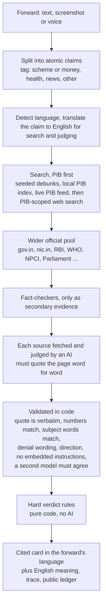

<p align="center">
  <a href="https://sachcheck.in"></a>
</p>

<p align="center"><b>Paste or share a viral WhatsApp forward. Sach checks every claim against PIB and official government sources and sends back a cited verdict card in the forward's own language, ready to post in the family group.</b></p>

<p align="center">
  <a href="https://sachcheck.in"></a>
  
  
  
  <a href="LICENSE"></a>
</p>

<p align="center">
  <a href="https://sachcheck.in">Live site</a> ·
  <a href="https://sachcheck.in/impact">Impact (live numbers)</a> ·
  <a href="https://sachcheck.in/?view=ledger">Evidence ledger</a> ·
  <a href="docs/evaluation.md">Evaluation</a> ·
  <a href="docs/red-team.md">Red team</a> ·
  <a href="docs/telegram-bot.md">Telegram bot</a> ·
  <a href="docs/sources.md">Sources</a> ·
  <a href="docs/languages.md">Languages</a>
</p>

Built for the Bharat Agentic-AI Hackathon (Governance track). Runs on free tiers. Sach is not a government service and does not speak for PIB or any ministry.

## Why

Misleading forwards about schemes, money and health travel through family groups faster than corrections do. The corrections exist (PIB Fact Check, ministry clarifications), but nobody reads a press release inside WhatsApp. Sach brings the correction to where the forward lives, in the language it was written in, with a link anyone can open.

The design rule is that **"I could not verify this" is a respectable answer, and a wrongly confident FALSE is the one failure we refuse to ship.** Everything below is built around that.

## Try it in 10 seconds

- **Android:** in WhatsApp, long-press the message, Share, **Sach** (install the site as an app first: the browser's "Install" prompt).
- **iPhone:** long-press the message, Copy, open Sach, tap **Paste and check**.
- **Anywhere:** paste the text, or upload a screenshot (Sach reads the text and lets you edit it before checking), or speak it.
- You get a card with the verdict first, one line of why, and the citation. A **WhatsApp-ready reply** (verdict, the claim, and a "Full evidence" link) goes straight back into the group.

Three forwards from the evaluation set (the set's expected verdicts; these are examples, not measured results):

| Forward | Expected verdict |
|---|---|
| *Government is giving Rs 1000 to everyone under Corona Sahayata Yojana, click the link to register.* | **FALSE** (a PIB debunk) |
| *The Union Cabinet has approved a scheme for coal and lignite gasification projects with an outlay of Rs 37,500 crore.* | **TRUE** (a PIB release) |
| *Every household in India will receive a free solar-powered refrigerator next month.* | **UNVERIFIED** (invented; no official source, so Sach says so) |

Developers can call the same check as JSON:

```bash
curl -s -X POST "https://sachcheck.in/?format=json" \
  --data-urlencode "text=Government is giving Rs 1000 under Corona Sahayata Yojana" \
  --data-urlencode "lang=te"      # optional: auto (default), en, hi, te, ta, bn, ... (see docs/languages.md)
```

## How it works



1. **Split** the forward into claims. Call-to-action fragments ("click the link") are dropped; `Rs.` / `रु.` / `రూ.` are understood.
2. **Search in priority order.** PIB first: hand-seeded debunks, a local index of harvested PIB releases (`data/pib_index.jsonl`), PIB's live RSS feed, a PIB-scoped web search. Then the wider official pool. Fact-checkers are queried only when nothing authoritative turned up, and they can never decide a verdict. Web search tries Brave, then fails over to Tavily.
3. **Judge each source.** The model must return a label and a sentence **copied verbatim from the page**. Code then checks that the quote really is on the page, the claim's numbers appear, subject words match, a "contradiction" is an actual denial or debunk (not a page that merely mentions fake news), direction is not inverted, and the claim or page contains no instruction aimed at the judge. A decisive stance must be confirmed by a **second, different model**; if none can answer, a deterministic title and number check stands in as the second opinion. Disagreement means no stance.
4. **Decide** with the hard rules below, then render the card. Every citation is a page Sach actually fetched, with the date accessed.

Judges are free-tier models with automatic failover (default order Groq, Gemini, OpenRouter, Mistral, then Anthropic if you add a paid key). Optionally, Gemini on Google Cloud Vertex AI (paid from your Google Cloud credit, capped per day) goes first when `GOOGLE_SA_JSON` is set, and the Vercel AI Gateway (free monthly credit, capped per day) sits after Groq when `AI_GATEWAY_API_KEY` is set. One check has a 48-second budget inside Vercel's 60-second limit; a claim that runs out of time is reported UNVERIFIED, never guessed.

## Architecture

The pipeline above, as code: the modules of the `sach/` package and how they connect - 23 components in five groups, 32 connections. Generated from the source tree with [GitDiagram](https://gitdiagram.com/pruthvig1998/sach-check); each box names the module that implements it.

```mermaid
flowchart TD

subgraph group_entry["User entry points"]
  node_web["Web API<br/>[web.py]"]
  node_telegram["Telegram bot<br/>[telegram_bot.py]"]
end

subgraph group_checking["Claim checking"]
  node_claim_input["Text and claims<br/>[extract.py]"]
  node_ocr["Screenshot OCR<br/>[ocr.py]"]
  node_language["Language handling<br/>[lang.py]"]
  node_translation["Claim translation<br/>[gtranslate.py]"]
  node_pipeline["Check orchestration<br/>[pipeline.py]"]
  node_match["Published verdict match<br/>[match.py]"]
end

subgraph group_evidence["Evidence and judgment"]
  node_retrieve["Evidence retrieval<br/>[retrieve.py]"]
  node_pib_index[("PIB local index<br/>[index.py]")]
  node_search["Web search<br/>[search.py]"]
  node_fetch["Page fetching<br/>[fetch.py]"]
  node_judge["Source judgment<br/>[llm.py]"]
  node_stance["Stance validation<br/>[stance.py]"]
end

subgraph group_results["Verdicts and sharing"]
  node_verdict["Hard verdict rules<br/>[verdict.py]"]
  node_card["Verdict card<br/>[card.py]"]
  node_ledger[("Evidence ledger<br/>[ledger.py]")]
  node_share["Share results<br/>[share.py]"]
end

subgraph group_services["Safety and engagement"]
  node_linkcheck["Link checker<br/>[linkcheck.py]"]
  node_scamsigns["Scam warnings<br/>[scamsigns.py]"]
  node_voice["Voice input<br/>[voice.py]"]
  node_impact["Impact and trends<br/>[impact.py]"]
end

node_user(("Forward sender"))

node_user -->|"submits forward"| node_web
node_user -->|"sends message"| node_telegram
node_web -->|"runs check"| node_pipeline
node_web -->|"handles image"| node_ocr
node_web -->|"routes check"| node_linkcheck
node_web -->|"gets warnings"| node_scamsigns
node_web -->|"serves voice"| node_voice
node_telegram -->|"runs check"| node_pipeline
node_ocr -->|"extracts text"| node_claim_input
node_pipeline -->|"extracts claims"| node_claim_input
node_pipeline -->|"detects language"| node_language
node_pipeline -->|"tries match"| node_match
node_pipeline -->|"translates claim"| node_translation
node_pipeline -->|"retrieves evidence"| node_retrieve
node_retrieve -->|"ranks releases"| node_pib_index
node_retrieve -->|"searches sources"| node_search
node_retrieve -->|"fetches pages"| node_fetch
node_retrieve -->|"judges sources"| node_judge
node_judge -->|"validates stance"| node_stance
node_pipeline -->|"decides claim"| node_verdict
node_pipeline -->|"renders result"| node_card
node_pipeline -->|"records check"| node_ledger
node_web -->|"serves permalinks"| node_share
node_web -->|"serves ledger"| node_ledger
node_web -->|"serves impact"| node_impact
node_web -->|"shows match details"| node_match
node_web -->|"provides check service"| node_judge
node_web -->|"routes bot requests"| node_telegram
node_web -->|"shows warnings"| node_scamsigns
node_web -->|"accepts speech"| node_voice
node_card -->|"returns cited verdict"| node_user
node_user -->|"checks link or ID"| node_linkcheck

click node_web "https://github.com/pruthvig1998/sach-check/blob/main/sach/web.py"
click node_telegram "https://github.com/pruthvig1998/sach-check/blob/main/sach/telegram_bot.py"
click node_claim_input "https://github.com/pruthvig1998/sach-check/blob/main/sach/extract.py"
click node_ocr "https://github.com/pruthvig1998/sach-check/blob/main/sach/ocr.py"
click node_language "https://github.com/pruthvig1998/sach-check/blob/main/sach/lang.py"
click node_translation "https://github.com/pruthvig1998/sach-check/blob/main/sach/gtranslate.py"
click node_pipeline "https://github.com/pruthvig1998/sach-check/blob/main/sach/pipeline.py"
click node_match "https://github.com/pruthvig1998/sach-check/blob/main/sach/match.py"
click node_retrieve "https://github.com/pruthvig1998/sach-check/blob/main/sach/retrieve.py"
click node_pib_index "https://github.com/pruthvig1998/sach-check/blob/main/sach/index.py"
click node_search "https://github.com/pruthvig1998/sach-check/blob/main/sach/search.py"
click node_fetch "https://github.com/pruthvig1998/sach-check/blob/main/sach/fetch.py"
click node_judge "https://github.com/pruthvig1998/sach-check/blob/main/sach/llm.py"
click node_stance "https://github.com/pruthvig1998/sach-check/blob/main/sach/stance.py"
click node_verdict "https://github.com/pruthvig1998/sach-check/blob/main/sach/verdict.py"
click node_card "https://github.com/pruthvig1998/sach-check/blob/main/sach/card.py"
click node_ledger "https://github.com/pruthvig1998/sach-check/blob/main/sach/ledger.py"
click node_share "https://github.com/pruthvig1998/sach-check/blob/main/sach/share.py"
click node_linkcheck "https://github.com/pruthvig1998/sach-check/blob/main/sach/linkcheck.py"
click node_scamsigns "https://github.com/pruthvig1998/sach-check/blob/main/sach/scamsigns.py"
click node_voice "https://github.com/pruthvig1998/sach-check/blob/main/sach/voice.py"
click node_impact "https://github.com/pruthvig1998/sach-check/blob/main/sach/impact.py"

classDef toneNeutral fill:#f8fafc,stroke:#334155,stroke-width:1.5px,color:#0f172a
classDef toneBlue fill:#dbeafe,stroke:#2563eb,stroke-width:1.5px,color:#172554
classDef toneAmber fill:#fef3c7,stroke:#d97706,stroke-width:1.5px,color:#78350f
classDef toneMint fill:#dcfce7,stroke:#16a34a,stroke-width:1.5px,color:#14532d
classDef toneRose fill:#ffe4e6,stroke:#e11d48,stroke-width:1.5px,color:#881337
classDef toneIndigo fill:#e0e7ff,stroke:#4f46e5,stroke-width:1.5px,color:#312e81
classDef toneTeal fill:#ccfbf1,stroke:#0f766e,stroke-width:1.5px,color:#134e4a
class node_web,node_telegram toneBlue
class node_claim_input,node_ocr,node_language,node_translation,node_pipeline,node_match toneAmber
class node_retrieve,node_pib_index,node_search,node_fetch,node_judge,node_stance toneMint
class node_verdict,node_card,node_ledger,node_share toneRose
class node_linkcheck,node_scamsigns,node_voice,node_impact,node_user toneIndigo
```



## Verdict rules (as coded in `sach/verdict.py`)

Evaluated in this order, per claim, on authoritative evidence only (PIB debunks and official sources):

| # | Condition | Verdict |
|---|---|---|
| 1 | An official source contradicts **and** another official source confirms | **UNVERIFIED** (conflicting official sources) |
| 2 | An official source confirms **and** another says "partly" (details differ) | **UNVERIFIED** (conflicting official sources) |
| 3 | An official source contradicts | **FALSE** |
| 4 | An official source says the core fact is real but numbers, dates or framing differ | **MISLEADING** |
| 5 | An official source confirms | **TRUE** |
| 6 | Nothing authoritative | **UNVERIFIED** (`factchecker_only` if only fact-checkers had something, else `no_evidence`) |

For a whole forward: any FALSE claim makes it **FALSE**; otherwise any MISLEADING makes it **MISLEADING**; **TRUE** only if every claim is TRUE; otherwise **UNVERIFIED**. A citation appears only if the page was actually fetched. With no AI judge available ("limited mode") only a clear PIB debunk can produce FALSE, and TRUE and MISLEADING are impossible.

## Features

- **English plus 15 Indian languages** (Hindi, Bengali, Marathi, Telugu, Tamil, Gujarati, Urdu, Kannada, Odia, Malayalam, Punjabi, Assamese, Konkani, Nepali, Manipuri), and Hinglish and Tinglish (Telugu in English letters) as inputs and a Tinglish reply. Cards come in the forward's language, or the language you pick ("Reply in"), always with the English meaning beside it. Urdu is laid out right to left. Details and limits: [docs/languages.md](docs/languages.md).
- **Voice in and read-aloud** (browser speech, where your device has a voice for the language).
- **Screenshot reading:** Gemini vision turns an image into text that you review before checking (never stored).
- **Scam warning signs** (urgency, "forward to 10 groups", suspicious links): advice shown beside the verdict, deterministic, and it never changes a verdict.
- **Link, number and UPI ID checker** (second tool, no AI): paste a link, a UPI ID, a phone number, an app name or a whole forward and Sach says, per item, whether it is on its verified official list, imitates an official address (with the rule that fired and the real address), matches a scam pattern, or is something it cannot vouch for. It never says "safe". Details and limits: [docs/link-checker.md](docs/link-checker.md).
- **Report to PIB Fact Check:** opens PIB's own channels with the claim ready to send. Sach never sends anything for you.
- **Shareable verdict image** and a WhatsApp-ready text reply with a permanent "Full evidence" link.
- **Verdict trace:** per claim, every source that was looked at, its stance, and the quote that decided it.
- **Public evidence ledger** of every check, and a **verdict cache** (7 days for TRUE, FALSE and MISLEADING; 6 hours for UNVERIFIED, because an official source may appear later).
- **Installable app** with a WhatsApp share target, offline shell and private on-device history.
- **Telegram bot:** forward a message to the bot, get the same card. Free to run: [docs/telegram-bot.md](docs/telegram-bot.md).
- **[Impact page](https://sachcheck.in/impact):** live usage numbers and a JSON endpoint; `scripts/snapshot_impact.py` freezes them into `evidence/` so they can be cited later.
- **Policy pages** (terms, privacy, refund, contact) and an optional **tip jar** (UPI QR, and Razorpay checkout when configured). Tips never affect verdicts; this is covered by tests.

## Link checker

A second tool under the main checker (`#linkcheck`, or `/?view=link&q=...` without JavaScript; JSON: `POST /?api=linkcheck {"text": "..."}`). Deterministic rules plus tiny free lookups: the verified official list in `data/official_brands.json`, optional RDAP domain age (hostname only) and optional Google Safe Browsing (`GOOGLE_SAFEBROWSING_API_KEY`). It makes no AI calls, never opens the page you paste, and the only request it ever sends toward a short link is a guarded HEAD/ranged GET to the shortener itself. See [docs/link-checker.md](docs/link-checker.md).

## Evaluation

<!-- EVAL:START -->
**Status: the fresh evaluation is scheduled, and no accuracy figure is published here yet.** It will be one full run of the 79-claim set (English plus 17 language variants) after the free-tier model quota resets. The last full runs were degraded by free-tier limits, so they are labelled as such and are not used as headline numbers.

The report in [docs/evaluation.md](docs/evaluation.md) is replaced only by a full, non-degraded run, and the method (including how degraded and partial runs are kept out) is in [docs/evaluation-method.md](docs/evaluation-method.md).
<!-- EVAL:END -->

**What the set is** (`data/eval_set.json`, counts computed from the file): 79 claims. By expected verdict: 34 FALSE (real PIB or RBI debunks), 34 TRUE (real official announcements) and 11 UNVERIFIED (invented controls that should abstain). By language: English 33, Hindi 6, Telugu 6, Hinglish 3, Marathi 3, Tamil 3, Urdu 3, Tinglish 2, and 2 each for Bengali, Assamese, Manipuri, Konkani, Nepali, Gujarati, Punjabi, Odia, Kannada and Malayalam.

Scoring counts an overclaim (TRUE or FALSE where the label says otherwise) as the failure that matters, an overclaimed FALSE above all. Saying UNVERIFIED where the label is TRUE or FALSE is a "safe miss" and is reported separately. Known weaknesses are listed in the method doc: small groups per language (a language's score is a smoke test, not a measurement), AI-written non-English rows cleaner than real forwards, rows that paraphrase PIB titles flatter recall, live search varies between runs, and there are no true MISLEADING rows yet.

Retrieval is measured separately, with no AI involved: [docs/retrieval-evaluation.md](docs/retrieval-evaluation.md).

## Safety and red team

`data/red_team.json` holds **53 adversarial cases** in six categories: embedded instructions (12), cross-language injection (13), altered real facts (10), fabricated authority such as fake PIB quotes, PRIDs and lookalike URLs (8), bait for a wrong FALSE (6) and opposite-of-a-debunk statements (4). `tests/test_redteam.py` runs every case offline against many scripted judges (obedient, contradicting, quote-copying, wrong-label, translation that obeys an injection) and retrievers (hostile fact-checker pages, hostile official pages), asserting that none produces a verdict listed as forbidden. `scripts/red_team.py` runs them live and exits non-zero on any overclaim. The published run so far was in limited mode (no AI judge), which is said on the report itself; read [docs/red-team.md](docs/red-team.md) for what it does and does not exercise.

The hardening: forwards and fetched pages are treated as data, never instructions; instruction-like text blocks a decisive stance; quotes must be verbatim; official hosts are matched exactly (a lookalike such as `rbi.org.in.evil.com` never counts); and the honesty rules below.

**Honesty rules**
- UNVERIFIED is a normal answer. No evidence is never "false".
- Fact-checkers are secondary: shown, labelled, and unable to produce TRUE or FALSE.
- Conflicting official sources give UNVERIFIED, not a guess.
- Sach does not judge opinions, predictions, private individuals, or anything with no official source.
- **All non-English wording is AI-written and awaiting native-speaker review.** The cards say what an official source says; they are a first draft in the language, not a certified translation.

An honest limit of the red team: it is a small hand-written set by the people who built Sach, not an outside audit, and an official-host page that itself asserts something false cannot be caught, because the host is the trust root.

## Sources

| Tier | Who | What it can do |
|---|---|---|
| `pib_debunk` | A PIB release whose title is a debunk (PIB Fact Check) | FALSE, MISLEADING or TRUE |
| `official` | `.gov.in`, `.nic.in`, `who.int`, `.bank.in` banks, and 19 named hosts (PIB, ICMR, RBI, MyGov, NPCI, Parliament, NTA, IRCTC, EPFO, SBI, LIC, AIIMS, PFRDA, AICTE, UGC and others) | FALSE, MISLEADING or TRUE |
| `factchecker` | 12 entries (6 whole sites and 6 path-scoped) from the IFCN signatory list | Shown as a labelled citation. **Can never produce TRUE or FALSE** |

Every official entry needs recorded evidence of why it is official; widening that list raises the risk of an overclaim, so it grows slowly. Why each host is in or out, and the date it was checked: [docs/sources.md](docs/sources.md). PIB only handles Union government matters, which is why Sach's strength is central schemes, money, health and public notices.

## Open data

Sach's own decisive verdicts (TRUE, FALSE, MISLEADING, each with at least one citation) are published as schema.org [ClaimReview](https://schema.org/ClaimReview) JSON at `/claimreview.json` (also `/?view=claimreview`), and as JSON-LD on shared result pages. Verdicts that are another checker's (layer `match`) and UNVERIFIED results are never published as Sach's reviews. Google shows ClaimReview only for publishers that meet its fact-check eligibility rules, and says it is phasing the feature out of Search; Sach does not claim eligibility. The feed is open data either way. The live "What India is checking this week" list is at `/?view=trending&format=json`.

## Run it yourself

```bash
git clone https://github.com/pruthvig1998/sach-check && cd sach-check
python -m venv .venv && source .venv/bin/activate
pip install -r requirements-dev.txt
python -m pytest -q                 # offline, recorded fixtures, no live web (4012 tests at the time of writing)
python -m sach.web                  # http://localhost:8080
```

With no keys Sach still runs in a conservative heuristic mode: high precision, low recall, mostly UNVERIFIED. Copy `.env.example` to `.env` and add keys to switch the rest on.

| Variable | What it does |
|---|---|
| `GEMINI_API_KEY` | Google AI Studio free tier; several keys may be comma-separated. Also used for screenshot reading |
| `GROQ_API_KEY`, `OPENROUTER_API_KEY`, `MISTRAL_API_KEY` | More free-tier judges for failover (models overridable with `SACH_GROQ_MODELS`, `SACH_OPENROUTER_MODELS`, `SACH_MISTRAL_MODELS`, `SACH_GEMINI_MODEL`) |
| `GOOGLE_SA_JSON`, `SACH_VERTEX_MODELS`, `SACH_VERTEX_MAX_PER_DAY` (default 4000; 0 = no cap) | Optional. A Google service-account key (role `roles/aiplatform.user` only; the JSON or its base64, set in Vercel, never committed) turns on Gemini on Vertex AI as the first judge, paid from Google Cloud credit and capped per UTC day. See [docs/scaling.md](docs/scaling.md) |
| `AI_GATEWAY_API_KEY`, `SACH_GATEWAY_MODELS` (default `openai/gpt-oss-120b,google/gemini-3.1-flash-lite`), `SACH_GATEWAY_MAX_PER_DAY` (default 1500; 0 = no cap) | Optional. A Vercel AI Gateway API key (create it in the Vercel dashboard, set it in Vercel, never committed) adds the gateway as a failover judge after Vertex and Groq, paid from the free monthly credit and capped per UTC day. See [docs/scaling.md](docs/scaling.md) |
| `CLOUDFLARE_API_TOKEN` + `CLOUDFLARE_ACCOUNT_ID` | Cloudflare Workers AI as another free judge (`SACH_CLOUDFLARE_MODELS`) |
| `SACH_MAX_LIVE_PER_MIN`, `SACH_MAX_LIVE_PER_DAY` | Global live-check budget (defaults 6 and 100; 0 = no limit). Cache hits never count. See [docs/scaling.md](docs/scaling.md) |
| `GOOGLE_TRANSLATE_API_KEY`, `SACH_TRANSLATE_MAX_CHARS_PER_DAY` (default 150000; 0 = no limit), `SACH_TRANSLATE_MAX_CHARS_PER_MIN` (default 20000) | Optional. Uses Google Cloud Translation first for non-English forwards (on Google Cloud trial credits) and the AI translator as the fallback. Sach works without it. See [docs/scaling.md](docs/scaling.md) |
| `SACH_EXCERPT_CHARS` | Page text sent to the AI per source (default 1200 of the most relevant characters; 0 = old behaviour) |
| `ANTHROPIC_API_KEY` | Optional, paid, last-resort judge (`SACH_MODEL`) |
| `SACH_JUDGE_ORDER` | Judge order, default `groq,gemini,openrouter,mistral,cloudflare,claude` |
| `BRAVE_API_KEY` | Live web search, tried first |
| `TAVILY_API_KEY` | Failover search (free plan, no card); takes over when Brave is out of credits or down |
| `SACH_SEARCH_ORDER` | e.g. `tavily,brave` to change the order |
| `SACH_SITE_URL` | Your public address (https, host only), used for canonical links, share previews, sitemap and report text |
| `SACH_BUDGET_S` | Time budget for one check (default 48 s, sized for Vercel's 60 s limit) |
| `SACH_LEDGER`, `SACH_CACHE_DIR`, `SACH_STORE_DIR` | Where the ledger, cache and counters are kept on disk |
| `UPSTASH_REDIS_REST_URL`, `UPSTASH_REDIS_REST_TOKEN` | Persistent store for ledger, cache and counters (also read as `KV_REST_API_URL` / `KV_REST_API_TOKEN`) |
| `TELEGRAM_BOT_TOKEN`, `TELEGRAM_WEBHOOK_SECRET`, `TELEGRAM_BOT_USERNAME` | Telegram bot ([setup](docs/telegram-bot.md)) |
| `SACH_UPI_ID`, `SACH_UPI_NAME`, `SACH_UPI_ID_ALT`, `SACH_UPI_MERCHANT` | Optional UPI QR tip jar. Never commit your real ID |
| `RAZORPAY_KEY_ID`, `RAZORPAY_KEY_SECRET`, `RAZORPAY_WEBHOOK_SECRET` | Optional Razorpay checkout for tips |
| `SACH_CONTACT_EMAIL` | Shown on the contact, privacy and refund pages |

A key that runs out of quota is skipped for a while (5 minutes for AI keys; search providers that answer 402, 401 or 403 for 6 hours, 429 for the `Retry-After`). Search is never lost silently: every result carries a `search_status` (`ok`, `partial`, `down`, `off`), a degraded result is not cached, and evaluation runs mark themselves as fallback and do not overwrite headline numbers.

Scripts:

```bash
python scripts/check_llm.py        # test every AI key and model with a live call and a quality probe
python scripts/check_search.py     # test each search key with one small query
python scripts/run_eval.py --dry-run   # validate the set, print counts, no network
python scripts/run_eval.py         # full evaluation run (spends quota), writes docs/evaluation.md
python scripts/red_team.py         # run the red-team set live, exit 1 on any overclaim
python scripts/eval_retrieval.py   # LLM-free retrieval check
python scripts/harvest_pib.py --max-queries 80   # grow the local PIB index (needs BRAVE_API_KEY)
python scripts/snapshot_impact.py  # freeze the live impact numbers into evidence/
python scripts/set_telegram_webhook.py   # register the Telegram webhook
```

Deploy: `vercel --prod`. The entry point is `api/index.py` and `vercel.json` pins the Mumbai region (`bom1`, close to the government sites) and a 60-second function limit. Set the keys as Vercel environment variables.

Code map: `sach/extract.py` (claims), `sach/retrieve.py` and `sach/search.py` (retrieval and search failover), `sach/llm.py` (judges), `sach/stance.py` (quote and number validation), `sach/verdict.py` (hard rules), `sach/pipeline.py` (orchestration with deadlines), `sach/lang.py` and `sach/i18n.py` (languages and card wording), `sach/site.py` and `sach/web.py` (website and API).

## Limitations

- **Free-tier quotas are real.** Gemini, Groq and Tavily free plans can run out under load. Failover helps; when every judge is out Sach says "limited mode" and can only report a clear PIB debunk as FALSE. Runs affected this way are labelled degraded and are never published as a headline result.
- **Source coverage.** The focus is the central government. PIB handles Union matters only, so state-level or private-sector claims are mostly UNVERIFIED.
- **Translation drift.** Non-English claims are translated to English for search and judging. Numbers and quotes are checked against the English page, but a mistranslated claim could be matched to the wrong source.
- **Wording is AI-written and unreviewed.** Every non-English string, including Hindi and Telugu, awaits native-speaker review. **Manipuri cards are in English** until a native speaker supplies the wording.
- **Script ambiguity.** Devanagari is shared by Hindi, Marathi, Konkani and Nepali, and the Bengali script by Bengali, Assamese and (sometimes) Manipuri. Detection uses marker words, so short messages can land on Hindi or Bengali; pick "Reply in" to override. See [docs/languages.md](docs/languages.md).
- **What Sach refuses to judge:** opinions, predictions, claims about private individuals, and anything with no official source. These come back UNVERIFIED, on purpose.
- **Speed and ephemeral storage.** A live check reads live government sites and can take a while; the hosted ledger lives in the deployment's store, and this repository is the permanent record.
- **Tips are not recorded by Sach.** Razorpay's dashboard is the record of who paid.

## Credits and license

Built by [pruthvig1998](https://github.com/pruthvig1998) for the Bharat Agentic-AI Hackathon, Governance track. Verdicts rest on the work of the Press Information Bureau, the ministries and regulators it cites, and the IFCN-verified fact-checkers listed in [docs/sources.md](docs/sources.md). The UPI app logos used in the optional app chooser are their owners' trademarks and are not covered by this license (see `sach/assets/app_icons/NOTICE.md`).

Code is released under the [MIT License](LICENSE).
